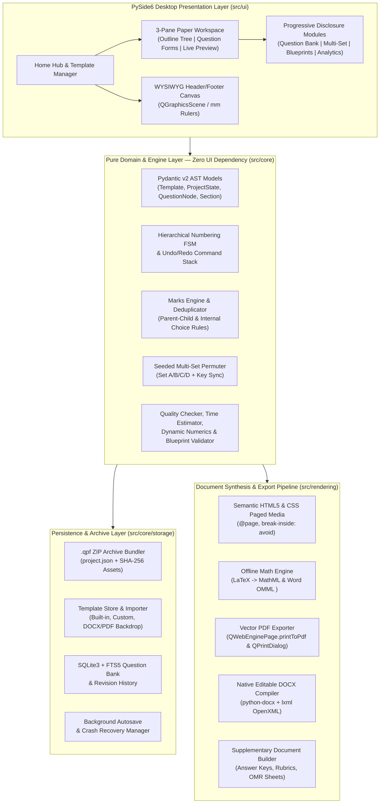

<div align="center">

# 🎓 Question Paper Studio
### Template-Based Question Paper Creation & Management Studio

[](https://www.python.org/)
[-41CD52?style=for-the-badge&logo=qt&logoColor=white)](https://wiki.qt.io/Qt_for_Python)
[](https://github.com/aniket296/question-paper-studio)
[](https://github.com/aniket296/question-paper-studio)
[](LICENSE)

**An industry-grade, 100% offline desktop software studio enabling educators, schools, and universities to design millimeter-accurate visual templates, author multi-format examination question papers, manage FTS5-indexed question banks, generate randomized multi-set papers (Set A/B/C/D) with synchronized answer keys, and export print-ready vector PDFs and editable Microsoft Word (`.docx`) documents with native OMML equations.**

</div>

---

## 🌟 Problem Statement & Core Philosophy

Educators spend countless hours wrestling with fragile word processor tab stops, broken page breaks across multi-part questions, inconsistent numbering hierarchies, manual marks tallying, and error-prone answer key updates when shuffling Set A/B/C/D exams. Existing enterprise exam platforms often force rigid workflows—requiring teachers to configure complex Bloom's taxonomy matrices, course outcomes, and blueprints just to type a 20-mark class test.

### *"Simple by Default, Powerful When Needed"*

**Question Paper Studio** is engineered around two foundational pillars:

1. **Zero Forced Complexity (Basic Mode by Default):**
   Open the application $\rightarrow$ Click **Create Question Paper** $\rightarrow$ Select a visual **Template** $\rightarrow$ *(Optionally)* fill basic exam metadata $\rightarrow$ Add Questions (*Normal, MCQ, Fill in the Blanks, Match the Pair*) $\rightarrow$ Preview in real time $\rightarrow$ Save (`.qpf`) or Export (**PDF / DOCX**) & Print.
2. **Progressive Disclosure for Advanced Examination Workflows:**
   Every advanced capability—*Sections, Internal Choices (`OR` / Any $K$ of $N$), Arbitrary Sub-question Hierarchy, Multi-Set Shuffling (Set A/B/C/D), Marking Rubrics, Blueprints, SQLite FTS5 Question Bank, Shared Reading Passages, Dynamic Parameterized Numerics, Quality Checks, and Post-Exam Item Analytics*—remains cleanly tucked inside optional drawers and collapsible panels until explicitly enabled.

---

## 🏗️ System Architecture



### Strict Decoupling & Snapshot Immutability
- **Header/Footer Visual Isolation:** Templates define **only** Page Setup (`A4`, `A3`, `Letter`, `Custom`; `Portrait`/`Landscape`; `Margins`), the **Header Zone**, and the **Footer Zone**. The middle body zone is strictly locked and reserved for dynamically generated question paper content.
- **Snapshot Immutability:** Creating a question paper embeds a complete deep-copy snapshot of the chosen template inside the `.qpf` archive. Modifying or deleting a template or Question Bank item later **never** breaks or mutates previously saved question papers.

---

## 📊 Feature Matrix: Basic Mode vs. Advanced Modules

| Capability | Basic Mode (Default Experience) | Progressive Disclosure (Optional / Advanced) |
| :--- | :--- | :--- |
| **Paper Structure** | Single unsectioned question list with automatic `1, 2, 3...` numbering | Multi-section papers (`Section A, B, C`), per-section instructions, custom numbering (`I, II, III`, `A, B, C`, `a, b, c`, `i, ii, iii`) |
| **Question Hierarchy** | Flat top-level questions | Arbitrary recursive nesting (`Parent` $\rightarrow$ `Minor` $\rightarrow$ `Subquestion` $\rightarrow$ `Further Subquestion`) with drag-and-drop reparenting |
| **Question Types** | **Normal**, **MCQ** (dynamic options, auto A/B/C/D), **Fill in the Blanks** (with/without word bank), **Match the Pair** | **True/False**, **Short/Long Answer**, **Assertion-Reason**, **Case-Based**, **Dynamic Numerical**, **Ordering**, **Diagram Labelling**, **Source-Based** |
| **Marks & Choices** | Direct marks input per question with live total bar | Parent-child automatic sum deduplication, Internal Choices (`OR` pairs, *"Answer any $K$ out of $N$"*), discrepancy warnings |
| **Formatting & Math** | Bold, Italic, Underline, Sup/Sub, Lists, Tables, Images, LaTeX Equations (`$...$`), Symbols | Bilingual Mode (**English + Hindi / Marathi** via bundled Noto Sans Devanagari) in Sequential or Side-by-Side layout |
| **Paper Generation** | Single paper + instant Student Preview & Answer Key toggle | **Multi-Set Shuffler (Set A, B, C, D)** with synchronized per-set Answer Keys, Marking Rubrics, and Candidate/OMR Sheets |
| **Library & Quality** | Save/Open `.qpf` project files with automatic crash recovery | **SQLite FTS5 Question Bank**, Bulk DOCX/CSV/TXT Importer, Blueprints, Quality Checker, Previous Paper Diff, Post-Exam CSV Analytics |

---

## 🚀 Quick-Start Installation Guide

### Prerequisites
- **Python 3.12+** (Tested on Python 3.12 – 3.14)
- **Operating System:** Windows 10/11 (64-bit), Linux, or macOS

### 1. Clone the Repository
```bash
git clone https://github.com/aniket296/question-paper-studio.git
cd question-paper-studio
```

### 2. Create & Activate Virtual Environment
**Windows (PowerShell):**
```powershell
python -m venv .venv
.\.venv\Scripts\Activate.ps1
pip install -r requirements.txt
```

**Linux / macOS:**
```bash
python3 -m venv .venv
source .venv/bin/activate
pip install -r requirements.txt
```

### 3. Verify Bundled Fonts & Default Assets
```bash
python scripts/generate_default_assets.py
```

---

## 🖥️ Running from Source

Launch the desktop application:
```bash
python -m src.main
```

Run the headless self-test diagnostics (verifies database, bundled fonts, models, and rendering pipelines):
```bash
python -m src.main --self-test
```

---

## 🧪 Running the Automated Test Suite

Execute the complete `pytest` verification suite:
```bash
pytest
```

Run specific test modules:
```bash
pytest tests/test_environment.py
pytest tests/test_models.py
pytest tests/test_numbering_and_tree.py
pytest tests/test_engines.py
pytest tests/test_storage.py
pytest tests/test_html_pdf_rendering.py
pytest tests/test_docx_exporter.py
```

---

## 📦 Building the Standalone Windows `.exe` Distribution

Question Paper Studio packages into a fast-starting `--onedir` Windows application using **PyInstaller** and an **Inno Setup** installer script:

```bash
python scripts/build_windows.py
```

- **Standalone Portable Folder:** `dist/QuestionPaperStudio/QuestionPaperStudio.exe`
- **Windows Setup Installer:** Compile `scripts/installer.iss` with Inno Setup to produce `Output/Setup_QuestionPaperStudio.exe` (includes Desktop shortcut, Start Menu entry, and `.qpf` file association).

---

## 📁 Repository Structure

```text
question-paper-studio/
├── assets/
│   ├── fonts/                  # Bundled NotoSans & NotoSansDevanagari TTF fonts
│   ├── icons/                  # Clean SVG UI icons & Windows .ico app icon
│   ├── math/                   # Offline MathML/OMML helpers & Unicode symbol catalog
│   └── templates/              # Built-in default templates (School, University, Compact)
├── src/
│   ├── main.py                 # Entry point, font registration, crash recovery check
│   ├── core/                   # Pure domain models, numbering FSM, marks engine, SQLite bank
│   ├── rendering/              # HTML5/CSS Paged Media compiler, PDF exporter, OMML DOCX builder
│   └── ui/                     # PySide6 GUI (Home Hub, Template Canvas, 3-Pane Workspace)
├── scripts/
│   ├── generate_default_assets.py
│   ├── build_windows.py
│   └── installer.iss
├── tests/                      # Comprehensive pytest & pytest-qt verification suite
├── pyproject.toml
├── requirements.txt
└── README.md
```

---

## 📄 License

Distributed under the **MIT License**. Built with precision for educators everywhere.

