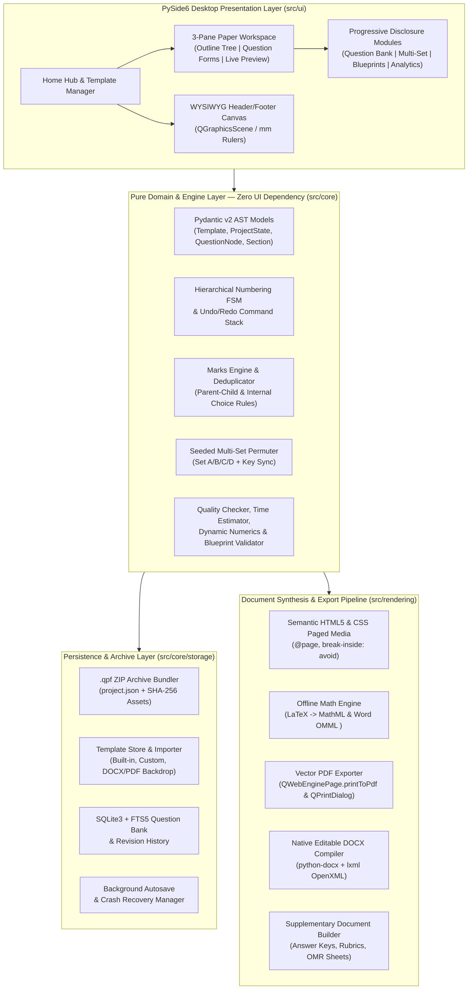

<div align="center">

# 🎓 Question Paper Studio
### Template-Based Question Paper Creation & Management Studio

[](https://www.python.org/)
[-41CD52?style=for-the-badge&logo=qt&logoColor=white)](https://wiki.qt.io/Qt_for_Python)
[](https://github.com/aniket296/question-paper-studio)
[](https://github.com/aniket296/question-paper-studio)
[](LICENSE)

**An industry-grade, 100% offline desktop software studio enabling educators, schools, and universities to design millimeter-accurate visual templates, author multi-format examination question papers, manage FTS5-indexed question banks, generate randomized multi-set papers (Set A/B/C/D) with synchronized answer keys, and export print-ready vector PDFs and editable Microsoft Word (`.docx`) documents with native OMML equations.**

</div>

---

## 🌟 Problem Statement & Core Philosophy

Educators spend countless hours wrestling with fragile word processor tab stops, broken page breaks across multi-part questions, inconsistent numbering hierarchies, manual marks tallying, and error-prone answer key updates when shuffling Set A/B/C/D exams. Existing enterprise exam platforms often force rigid workflows—requiring teachers to configure complex Bloom's taxonomy matrices, course outcomes, and blueprints just to type a 20-mark class test.

### *"Simple by Default, Powerful When Needed"*

**Question Paper Studio** is engineered around two foundational pillars:

1. **Zero Forced Complexity (Basic Mode by Default):**
   Open the application $\rightarrow$ Click **Create Question Paper** $\rightarrow$ Select a visual **Template** $\rightarrow$ *(Optionally)* fill basic exam metadata $\rightarrow$ Add Questions (*Normal, MCQ, Fill in the Blanks, Match the Pair*) $\rightarrow$ Preview in real time $\rightarrow$ Save (`.qpf`) or Export (**PDF / DOCX**) & Print.
2. **Progressive Disclosure for Advanced Examination Workflows:**
   Every advanced capability—*Sections, Internal Choices (`OR` / Any $K$ of $N$), Arbitrary Sub-question Hierarchy, Multi-Set Shuffling (Set A/B/C/D), Marking Rubrics, Blueprints, SQLite FTS5 Question Bank, Shared Reading Passages, Dynamic Parameterized Numerics, Quality Checks, and Post-Exam Item Analytics*—remains cleanly tucked inside optional drawers and collapsible panels until explicitly enabled.

---

## 🏗️ System Architecture



### Strict Decoupling & Snapshot Immutability
- **Header/Footer Visual Isolation:** Templates define **only** Page Setup (`A4`, `A3`, `Letter`, `Custom`; `Portrait`/`Landscape`; `Margins`), the **Header Zone**, and the **Footer Zone**. The middle body zone is strictly locked and reserved for dynamically generated question paper content.
- **Snapshot Immutability:** Creating a question paper embeds a complete deep-copy snapshot of the chosen template inside the `.qpf` archive. Modifying or deleting a template or Question Bank item later **never** breaks or mutates previously saved question papers.

---

## 📊 Feature Matrix: Basic Mode vs. Advanced Modules

| Capability | Basic Mode (Default Experience) | Progressive Disclosure (Optional / Advanced) |
| :--- | :--- | :--- |
| **Paper Structure** | Single unsectioned question list with automatic `1, 2, 3...` numbering | Multi-section papers (`Section A, B, C`), per-section instructions, custom numbering (`I, II, III`, `A, B, C`, `a, b, c`, `i, ii, iii`) |
| **Question Hierarchy** | Flat top-level questions | Arbitrary recursive nesting (`Parent` $\rightarrow$ `Minor` $\rightarrow$ `Subquestion` $\rightarrow$ `Further Subquestion`) with drag-and-drop reparenting |
| **Question Types** | **Normal**, **MCQ** (dynamic options, auto A/B/C/D), **Fill in the Blanks** (with/without word bank), **Match the Pair** | **True/False**, **Short/Long Answer**, **Assertion-Reason**, **Case-Based**, **Dynamic Numerical**, **Ordering**, **Diagram Labelling**, **Source-Based** |
| **Marks & Choices** | Direct marks input per question with live total bar | Parent-child automatic sum deduplication, Internal Choices (`OR` pairs, *"Answer any $K$ out of $N$"*), discrepancy warnings |
| **Formatting & Math** | Bold, Italic, Underline, Sup/Sub, Lists, Tables, Images, LaTeX Equations (`$...$`), Symbols | Bilingual Mode (**English + Hindi / Marathi** via bundled Noto Sans Devanagari) in Sequential or Side-by-Side layout |
| **Paper Generation** | Single paper + instant Student Preview & Answer Key toggle | **Multi-Set Shuffler (Set A, B, C, D)** with synchronized per-set Answer Keys, Marking Rubrics, and Candidate/OMR Sheets |
| **Library & Quality** | Save/Open `.qpf` project files with automatic crash recovery | **SQLite FTS5 Question Bank**, Bulk DOCX/CSV/TXT Importer, Blueprints, Quality Checker, Previous Paper Diff, Post-Exam CSV Analytics |

---

## 🧭 End-to-End User Guide Workflows

### Workflow 1: Simple Paper Creation (Basic Mode)
1. **Launch & Select Template:** On the **Home Hub**, pick a built-in template (*Minimal Exam*, *Standard School A4*, or *University Semester*) and click **Create Question Paper**.
2. **Enter Metadata:** Fill the top Examination Bar (*Title, Subject, Class, Duration, Max Marks*). Click **▼ More Details** only if you need Subject Code, Exam Date, or General Instructions.
3. **Add Core Questions:** Click **+ Question** in the left Outline Tree and select from the 4 core types:
   - **Normal Question:** Rich prompt editor with equations (`$...$`), tables, and diagrams.
   - **Multiple Choice (MCQ):** Dynamic options (`A, B, C, D`), radio/checkbox correct key markers, and `inline` / `grid_2x2` / `stacked` layout selector.
   - **Fill in the Blank:** Toggle between *Without Options* and *With Word Bank* with ground-truth answers.
   - **Match the Pair:** Add Column A & Column B pairs and click **🎲 Shuffle Column B** while preserving the ground-truth answer mapping.
4. **Live Preview & Export:** Toggle **👨‍🎓 Student View** vs **👩‍🏫 Teacher Preview** in the right pane, then click **📤 Export (PDF / Word)** to generate vector PDFs, editable `.docx` files with native Word OMML equations (`Alt + =` compatible), separate Answer Keys, Marking Rubrics, and OMR Bubble Sheets.

### Workflow 2: Advanced University Exam & Multi-Set Generation
1. **Design Custom Header/Footer Template:** From the Home Hub, click **+ Create New Template** (or **Import DOCX/PDF Template**). Drag text blocks, logos, horizontal dividers, borders, and dynamic variable chips (`{{exam_name}}`, `{{subject_code}}`, `{{max_marks}}`, `{{page_number}}`) inside the millimeter-ruled Header and Footer zones.
2. **Structure Sections, Sub-Questions & Choices:**
   - Add sections (`+ Section`) or apply a standard pattern via **📐 Blueprint** (*CBSE 80M*, *JEE Main 100M*, *University 50M*, *Unit Test 25M*).
   - Right-click any question or section in the Outline Tree to configure **🔗 Choice Groups (`OR` Pairs / Any $K$ of $N$)** or attach **📖 Shared Reading Passages**.
   - Add nested sub-questions (`+ Sub-Q`): parent marks are automatically deduplicated from the sum of child marks.
3. **Progressive Disclosure Question Types & Bilingual Prompts:**
   - Expand `[+ More Question Types]` to author **Dynamic Numerical** (formula + variable ranges with live sample tester), **Assertion-Reason**, **Case-Based**, **Ordering/Sequencing**, **Diagram Labelling**, or **Source-Based** items.
   - Toggle **🌐 Bilingual / Secondary Language Prompt** on any question to enter parallel Hindi or Marathi text rendered with bundled **Noto Sans Devanagari**.
4. **Quality Audit & Multi-Set Shuffler:**
   - Click **🔍 Quality Audit** to inspect the Paper Health Score (0–100%) and jump directly to any question with missing answer keys or duplicate options.
   - Click **🔀 Multi-Set Generator** to produce deterministic parallel sets (*Set A, Set B, Set C, Set D*) that permute question order, MCQ options, Match-Pair Column B, and Dynamic Numerical variables while generating synchronized per-set Answer Keys and a **Master Cross-Set Equivalence Matrix**.

---

## ⌨️ Keyboard Shortcuts & Workspace Controls

| Action | Control / Shortcut | Context |
| :--- | :--- | :--- |
| **Save Question Paper (`.qpf`)** | `💾 Save Paper (.qpf)` | Workspace Top Toolbar |
| **Undo / Redo Project Action** | `↶ Undo` / `↷ Redo` | Workspace Top Toolbar (50-step deep snapshot stack) |
| **Bold / Italic / Underline** | `Ctrl+B` / `Ctrl+I` / `Ctrl+U` | Rich Text Question Prompt Editor |
| **Insert LaTeX Equation** | `∑ Math` (`$...$` inline, `$$...$$` block) | Rich Text Formatting Toolbar |
| **Insert Scientific Symbol** | `Ω Symbols` dropdown | Rich Text Formatting Toolbar |
| **Add Top-Level Question** | `+ Question` | Outline Tree Action Bar |
| **Add Nested Sub-Question** | `+ Sub-Q` | Outline Tree Action Bar |
| **Add New Section** | `+ Section` | Outline Tree Action Bar |
| **Move Question Up / Down** | `▲` / `▼` or Drag-and-Drop | Outline Tree Action Bar / Context Menu |
| **Zoom Print Preview** | `+` / `−` / `1:1` / `⤢ Fit` | Live Print Preview Toolbar |

---

## 🚀 Quick-Start Installation Guide

### Prerequisites
- **Python 3.12+** (Tested on Python 3.12 – 3.14)
- **Operating System:** Windows 10/11 (64-bit), Linux, or macOS

### 1. Clone the Repository
```bash
git clone https://github.com/aniket296/question-paper-studio.git
cd question-paper-studio
```

### 2. Create & Activate Virtual Environment
**Windows (PowerShell):**
```powershell
python -m venv .venv
.\.venv\Scripts\Activate.ps1
pip install -r requirements.txt
```

**Linux / macOS:**
```bash
python3 -m venv .venv
source .venv/bin/activate
pip install -r requirements.txt
```

### 3. Verify Bundled Fonts & Default Assets
```bash
python scripts/generate_default_assets.py
```

---

## 🖥️ Running from Source & CLI Options

Launch the desktop application in light mode:
```bash
python -m src.main
```

Launch with dark mode theme enabled or open a `.qpf` archive directly:
```bash
python -m src.main --dark path/to/exam_paper.qpf
```

Check version or run the headless self-test diagnostics (verifies database, bundled fonts, AST models, HTML5 compiler, DOCX OMML exporter, and GUI shell):
```bash
python -m src.main --version
python -m src.main --self-test
```

---

## 🧪 Running the Automated Test Suite

Execute the complete `pytest` verification suite (103 automated unit, engine, storage, rendering, UI, packaging, and E2E tests):
```bash
pytest -v
```

Run individual test suites by architectural layer:
```bash
pytest tests/test_environment.py                # Fonts, assets, and runtime environment
pytest tests/test_models.py                     # Pydantic v2 AST models & invariants
pytest tests/test_numbering_and_tree.py         # Hierarchical DFS numbering FSM & Undo/Redo
pytest tests/test_engines.py                    # Marks deduplication, quality audit, blueprints, dynamic numerics
pytest tests/test_storage.py                    # .qpf archive, SQLite FTS5 bank, DOCX/CSV importer, autosave
pytest tests/test_html_pdf_rendering.py         # HTML5/CSS Paged Media compiler & headless vector PDF
pytest tests/test_docx_exporter.py              # Native Word .docx & OMML (<m:oMath>) math converter
pytest tests/test_home_and_theme_ui.py          # Home screen launcher, template cards & theme manager
pytest tests/test_template_editor_ui.py         # WYSIWYG QGraphicsScene header/footer designer & clamping
pytest tests/test_workspace_shell.py            # 3-pane workspace shell, ExamInfoBar & OutlineTreeWidget
pytest tests/test_core_question_forms.py        # RichTextEditor & 4 core question type forms
pytest tests/test_preview_and_export_ui.py      # LivePreviewPane & multi-format batch ExportDialog
pytest tests/test_optional_types_and_layouts.py # 9 optional question forms, bilingual mode, OR/Passages
pytest tests/test_multi_set_shuffler.py         # Multi-Set generator (Set A/B/C/D) & equivalence matrix
pytest tests/test_advanced_modules.py           # Question Bank drawer, Blueprints, Quality panel & Post-Exam
pytest tests/test_packaging.py                  # PyInstaller --onedir build & Inno Setup verification
pytest tests/test_e2e_workflows.py              # Full Experience A & Experience B end-to-end workflows
```

---

## 📦 Building the Standalone Windows `.exe` Distribution

Question Paper Studio packages into a fast-starting `--onedir` Windows application using **PyInstaller** and an **Inno Setup 6** installer script:

```bash
python scripts/build_windows.py
```

The build pipeline automatically:
1. Verifies/generates all offline fonts (`NotoSans`, `NotoSansDevanagari`), icons (`app_icon.ico`), math XSLT helpers, and built-in JSON templates.
2. Runs PyInstaller in `--onedir --windowed` mode bundling `assets/`, `latex2mathml`, `python-docx`, and `PySide6.QtWebEngineWidgets` / `QtPrintSupport`.
3. Executes post-build smoke tests (`QuestionPaperStudio.exe --version` and `QuestionPaperStudio.exe --self-test`) to verify the compiled binary exits with code `0`.

- **Standalone Portable Distribution:** `dist/QuestionPaperStudio/QuestionPaperStudio.exe`
- **Single-File Windows Installer:** Open `scripts/installer.iss` in **Inno Setup Compiler** (or run `ISCC.exe scripts/installer.iss`) to generate `Output/Setup_QuestionPaperStudio.exe` with Desktop/Start Menu shortcuts and `.qpf` file associations.

---

## 📁 Repository Structure

```text
question-paper-studio/
├── assets/
│   ├── fonts/                  # Bundled NotoSans & NotoSansDevanagari TTF fonts
│   ├── icons/                  # Clean SVG UI icons & Windows .ico app icon
│   ├── math/                   # Offline MathML/OMML helpers & Unicode symbol catalog
│   └── templates/              # Built-in default templates (School, University, Compact)
├── src/
│   ├── main.py                 # Entrypoint, CLI flags (--self-test, --version, --dark), font setup
│   ├── core/
│   │   ├── models/             # Pydantic v2 AST models (Template, ProjectState, QuestionNode, Blueprint)
│   │   ├── engine/             # Numbering FSM, MarksEngine, MultiSetShuffler, QualityChecker, Validators
│   │   └── storage/            # QPFArchive, TemplateStore, SQLiteQuestionBank (FTS5), AutosaveManager
│   ├── rendering/              # HTMLCompiler, CSSGenerator, PDFExporter, DOCXExporter, MathConverter
│   └── ui/
│       ├── home/               # HomeScreen & TemplateImportDialog
│       ├── template_editor/    # WYSIWYG PageGraphicsScene, CanvasGraphicsItem & PropertyInspector
│       ├── workspace/          # WorkspaceScreen, OutlineTreeWidget, LivePreviewPane, 13 Question Forms
│       └── advanced/           # MultiSetDialog, QuestionBankDrawer, BlueprintDialog, Quality, PostExam
├── scripts/
│   ├── generate_default_assets.py
│   ├── build_windows.py
│   └── installer.iss
├── tests/                      # 17 automated pytest & pytest-qt verification modules (103 tests)
├── pyproject.toml
├── requirements.txt
└── README.md
```

---

## 📄 License

Distributed under the **MIT License**. Built with precision for educators everywhere.
